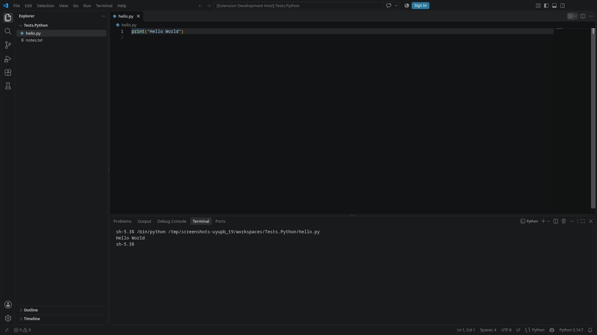

import { Code } from '@astrojs/starlight/components';
import pythonTest from '../../../../../examples/vscode-extension/tests/python.robot?raw';
import extensionsResource from '../../../../../examples/vscode-extension/tests/resources/extensions.resource?raw';
import pythonResource from '../../../../../examples/vscode-extension/tests/resources/python.resource?raw';

Every VS Code that `Start VS Code` starts has its own extensions directory, unless `extensions_dir` gives a prepared one. Neither your own VS Code nor other instances see what is in it. Extensions get into it in several ways. The libraries do not install extensions themselves; they provide the building blocks, and this page shows how to combine them:

- `extension_development_path` and `extensions_dir` of `Start VS Code`;
- `Execute VS Code CLI Command`, which runs VS Code's command-line script.

`Execute VS Code CLI Command` never works on your own VS Code. Without `executable`, it works on the directories of the active instance. With `executable`, it works on the directories that `Start VS Code` would get with the same arguments: the given ones, and fresh ones for the others. It also removes the variables that tie a process to a running VS Code: in VS Code's integrated terminal, `VSCODE_IPC_HOOK_CLI` would send the call to the VS Code that the terminal belongs to.

## From source

The extension under test is loaded from its folder, without being installed. Several folders are possible as well:

```robotframework
Start VS Code    ${VSCODE_EXECUTABLE}    ${EXECDIR}/tests/workspace    extension_development_path=${EXECDIR}
```

## Before VS Code starts

`Execute VS Code CLI Command` with `executable` installs Marketplace extensions or `.vsix` files into a directory of their own, and `Start VS Code` starts with a copy of it through `extensions_dir`:

```robotframework
Execute VS Code CLI Command    --install-extension    ms-python.python
...    executable=${VSCODE_EXECUTABLE}    extensions_dir=${CACHE}/extensions    user_data_dir=${CACHE}/user-data
Copy Directory    ${CACHE}/extensions    ${OUTPUT_DIR}/extensions/${TEST NAME}
Start VS Code    ${VSCODE_EXECUTABLE}    extensions_dir=${OUTPUT_DIR}/extensions/${TEST NAME}
```

- **Faster and offline:** if `${CACHE}` is a folder that later runs keep, the extensions are downloaded only once. A second `--install-extension` of an installed extension does nothing. With a folder under `${OUTPUT_DIR}` instead, every run downloads them again.
- **Dependencies come along.** Extensions that an installed extension declares as dependencies are installed too: `ms-python.python` brings Pylance, Python Environments and the Python Debugger.
- **Fixed versions:** `publisher.name@1.2.3` installs a fixed version instead of the newest one.
- **Pre-releases:** add `--pre-release`.
- **Forks** of VS Code install from their own gallery when `Execute VS Code CLI Command` gets the fork's `executable`; VSCodium, for example, uses Open VSX.
- **Same VS Code version:** prepare with the VS Code that starts the copy. Extensions declare which VS Code versions they support. The example keeps a folder per VS Code version, which `--version` reports.
- **A copy for each instance:** VS Code writes into its extensions directory while it runs. Instances that share one directory can corrupt it.

## Into the running VS Code

Installing while VS Code runs is useful to test how your extension reacts when another one arrives. Without `executable`, `Execute VS Code CLI Command` installs into the directories of the active instance:

```robotframework
Execute VS Code CLI Command    --install-extension    ms-python.python
```

When the script returns, the extension is on disk, but VS Code has not necessarily taken it in yet. Its extension host knows: once `vscode.extensions.getExtension` finds the extension there, the window has it. [`Evaluate In Extension Host`](../extension-host/) asks it, with the library's helper extension, which the example loads next to its own extension. `Wait Until Keyword Succeeds` repeats the question:

```robotframework
${known} =    Evaluate In Extension Host    (vscode, id) => vscode.extensions.getExtension(id) !== undefined
...    arg=ms-python.python
```

Two things can go wrong:

- **VS Code misses the install, or deletes the extension again.** VS Code's shared process keeps track of the installed extensions. When it starts, it reads the list of extensions, begins to watch it, and deletes extension folders that are not in the list. The workbench can show before that is over.
  - An extension installed in that moment does not reach the window. It may even be deleted again, while the shared process log still says "Extensions added from another source".
  - On a loaded machine, this happened to about one in five installs right after `Start VS Code`.
  - **Wait for the extension host before the install,** with `Evaluate In Extension Host    () => true`. It comes up later, and in our measurements no install failed after it.
  - **If the extension host does not know the extension after the install,** install it again and reload the window, so that VS Code reads its extensions anew. Uninstall it before; the uninstall fails when VS Code has deleted the extension, which does not matter.
- **The script fails on a busy file.** The running VS Code writes the list of extensions, `extensions.json`, at the same time, and the script fails with "Unable to write file '…/extensions.json'". Trying again helps.

The example's keyword `Install Into Running VS Code` does all of this, see [the example](#the-example). Without it, such tests pass on a fast machine and fail on a loaded CI runner.

## Listing, uninstalling and updating

The same keyword lists, uninstalls and updates the extensions of the active instance, or, with `executable` and the directories, of a prepared directory:

```robotframework
${list} =    Execute VS Code CLI Command    --list-extensions    --show-versions
Execute VS Code CLI Command    --uninstall-extension    ms-python.python
Execute VS Code CLI Command    --update-extensions
```

A running VS Code notices an uninstalled extension the same way as an installed one, with "Extensions removed from another source" in its shared process log. `code --help` lists all arguments of the command line.

## Switching extensions off

Command-line arguments of VS Code switch extensions off for one instance. This also works for VS Code's built-in extensions:

```robotframework
Start VS Code    ${VSCODE_EXECUTABLE}    args=${{ ["--disable-extension", "vscode.git"] }}
Start VS Code    ${VSCODE_EXECUTABLE}    args=${{ ["--disable-extensions"] }}
```

`--disable-extensions` switches off all installed extensions. Extensions loaded with `extension_development_path` still run.

## Workspace recommendations

The recommendations in a workspace's `.vscode/extensions.json` are only suggestions. VS Code does not install them. To test with them, read them and pass them on:

```robotframework
${json} =    Get File    ${EXECDIR}/tests/workspace/.vscode/extensions.json
${recommended} =    Evaluate    json.loads($json)["recommendations"]    modules=json
VAR    @{install}
FOR    ${extension}    IN    @{recommended}
    VAR    @{install}    @{install}    --install-extension    ${extension}
END
Execute VS Code CLI Command    @{install}
...    executable=${VSCODE_EXECUTABLE}    extensions_dir=${CACHE}/extensions    user_data_dir=${CACHE}/user-data
```

VS Code allows comments in this file, which `json.loads` does not accept.

## Profiles

VS Code profiles bundle settings and extensions. `args=${{ ["--profile", "Testing"] }}` opens an instance with a profile of that name, created empty if it does not exist. The command line installs into a profile with `--profile` only once the profile exists, and each instance starts with a fresh user-data directory without profiles, unless `user_data_dir` gives a prepared one. For tests, `settings` and the ways above are simpler.

## The example

The example project's `python.robot` runs the workspace's `hello.py` with the run button that the Python extension shows above a Python file. It does so twice: with the extension prepared once and copied into VS Code before it starts, and installed into the running VS Code:

<Code code={pythonTest} lang="robotframework" title="tests/python.robot" />

The keywords for the prepared copy and for the running VS Code are in a resource of their own:

<Code code={extensionsResource} lang="robotframework" title="tests/resources/extensions.resource" />

`Run Python File` comes from a resource that the example's video test uses as well:

<Code code={pythonResource} lang="robotframework" title="tests/resources/python.resource" />



## Things to know

- **Wait until the extension is ready.** An extension needs a moment to start.
  - Run too early, the Python extension reported an invalid interpreter or failed with "Unable to find workspace for given file", and did not run the file.
  - `Run Python File` therefore waits until the extension shows the chosen interpreter in the status bar. It then waits until VS Code has stopped redrawing the run button, which it does several times while the extension starts.
  - Look for such signs of readiness in the extensions you depend on.
- **Commands appear in a fresh palette.** A command palette that is already open does not show the commands of an extension that arrived later. The example's `Run Command` opens a fresh palette until the command is there, see [Writing your own workbench keywords](../workbench-keywords/).
- **Network and time.** The Python extension with its dependencies is about 100 MB. Prepared in a folder that later runs keep, it is downloaded once; installed into the running VS Code, for every instance. The example's Python tests are tagged `network`, so `-e network` leaves them out where there is no network access.
- **Interpreters and tools.** The Python extension runs the scripts with an interpreter it finds on the machine. Extensions that need tools, such as a language runtime, need them on the machines where the tests run, including CI.
