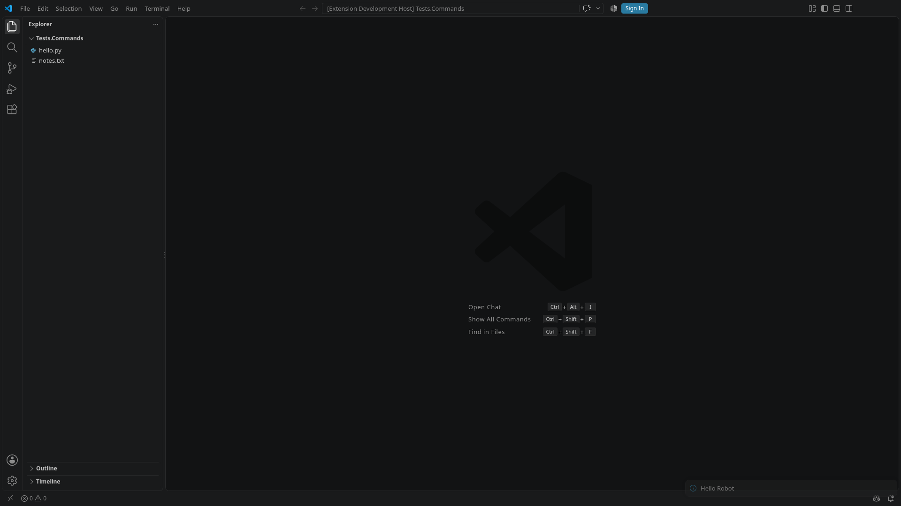

`VSCode` is built on `Electron` and the [Browser library](https://robotframework-browser.org). It contains every Electron and Browser keyword and starts isolated VS Code instances with the extension under test. The workbench window is an ordinary Browser page.

Everything in the [Electron section](../../electron/getting-started/) applies to VS Code as well: [Browser keywords in applications](../../electron/browser-keywords/), [traces and HAR files](../../electron/traces/), [videos](../../electron/videos/), and `Evaluate In Main Process` for [the main process](../../electron/getting-started/#the-main-process). The pages of this section add what is specific to VS Code.

## Installation

```sh
pip install robotframework-vscode
rfbrowser init --skip-browsers
```

The library brings `robotframework-electron` and the Browser library, and `rfbrowser init` completes the installation of the Browser library, as for [Electron applications](../../electron/getting-started/#installation).

## VS Code

The library starts a VS Code that you provide: an installed VS Code, a portable copy, a [fork](../forks/), or a build that [`@vscode/test-electron`](https://www.npmjs.com/package/@vscode/test-electron) downloads. It downloads nothing itself. For a fixed version, add `@vscode/test-electron` to the development dependencies of your extension, with Node.js 22 or later, and download VS Code once:

```sh
npm install --save-dev @vscode/test-electron
node -e "require('@vscode/test-electron').downloadAndUnzipVSCode('1.141.0').then(console.log)"
```

VS Code goes into `.vscode-test`, a folder for git to ignore, and the command prints the executable's path, on Linux `.vscode-test/vscode-linux-x64-1.141.0/code`. A variable in `robot.toml` keeps the path out of the tests:

```toml
[variables]
VSCODE_EXECUTABLE = ".vscode-test/vscode-linux-x64-1.141.0/code"
```

A profile can point the variable to another VS Code, see [VS Code versions and profiles](../versions/).

## First test

A test in an extension's repository, run from the extension's root folder (`${EXECDIR}`), with a workspace for the test in `tests/workspace`:

```robotframework
*** Settings ***
Library    VSCode

*** Test Cases ***
Extension Command Shows A Message
    Start VS Code    ${VSCODE_EXECUTABLE}    ${EXECDIR}/tests/workspace    extension_development_path=${EXECDIR}
    Keyboard Key    press    F1
    Keyboard Input    type    Robot Test: Say Hello
    Wait For Elements State    .quick-input-list .monaco-list-row[aria-label*="Robot Test: Say Hello"]    visible
    Keyboard Key    press    Enter
    Get Text    .notifications-toasts .notification-list-item-message    ==    Hello Robot
    Close VS Code
```

The command palette filters asynchronously, so the test waits for the command's row before pressing Enter.



The example project in the repository goes further, with its own keywords for the command palette, quick picks, notifications, webviews, the editor and the terminal; see [Writing your own workbench keywords](../workbench-keywords/).

## Starting VS Code

`Start VS Code` starts the VS Code of the given executable and returns once the workbench is ready. It returns the instance's id and the page details of the workbench window, like `Start Electron Application`.

- **Which VS Code:** the executable, as a path or as a command on `PATH`. Symbolic links are followed.
- **Extensions:**
  - `extension_development_path` loads one or more extensions from source.
  - `extensions_dir` starts the instance with a prepared extensions directory, for example one that `Execute VS Code CLI Command` filled with Marketplace extensions or `.vsix` files.
  - [Extensions](../extensions/) shows these and other ways, such as installing into the running instance.
- **Settings:** `settings` are written to the user settings of the instance's own user-data directory. The defaults switch off the welcome page, release notes, update checks, telemetry and workspace trust. They also switch off the screen reader mode, which VS Code otherwise turns on under Playwright, and hide the secondary side bar. Given settings override the defaults.
- **Isolation:** every instance gets its own user-data and extensions directories under the output directory. Neither the user's own VS Code nor other instances affect it. `user_data_dir` and `extensions_dir` give prepared directories instead, which the instance uses as they are. The library writes no settings into a given user-data directory, and `settings` cannot be combined with it: put the settings that the tests need, at least `"editor.accessibilitySupport": "off"`, into its `User/settings.json`. Tests that run in VS Code's terminal or test explorer start an instance that the surrounding VS Code does not affect.
- **Closing:** `Close VS Code` and Browser's automatic closing end the instance.

## Next steps

- [Extensions](../extensions/) for getting the extensions that your tests need into VS Code.
- [The extension host](../extension-host/) for VS Code's extension API in a test, for example to run a command by its id or to wait for a language server.
- [Browser keywords in VS Code](../browser-keywords/) for the Browser features that need a setting in VS Code.
- [Videos and traces of VS Code](../videos-and-traces/) for videos in which VS Code fills the frame.
- [CI and the Linux display](../../running/ci-and-display/) for running without a desktop.
- [VS Code versions and profiles](../versions/) for running the tests against several VS Code builds.
- [Instances, logs and troubleshooting](../instances/) for VS Code's logs, the instance directories and the cleanup of earlier runs.
